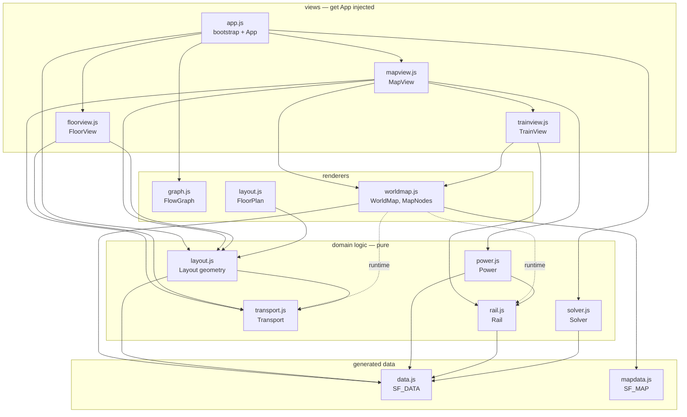
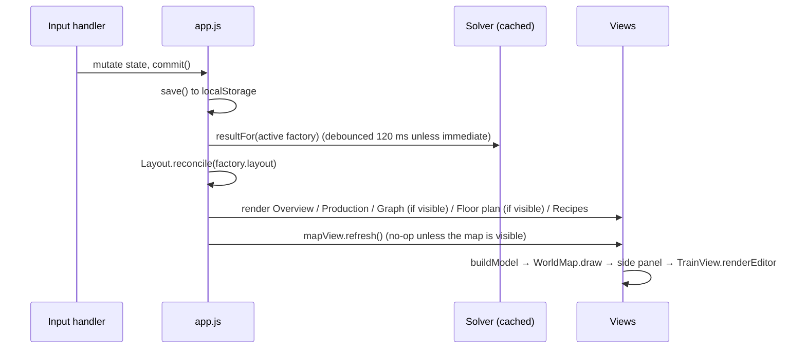

# Satisfactory Planner — Architecture and Code Design

This document explains how the planner is built: the design principles, the modules and how they depend on each
other, the saved-state model, the main algorithms, the data pipelines, and how to extend the code. For how to *use*
the app, see [USER_GUIDE.md](USER_GUIDE.md).

- [1. Design principles](#1-design-principles)
- [2. Repository layout](#2-repository-layout)
- [3. Modules and dependencies](#3-modules-and-dependencies)
- [4. Runtime composition and update flow](#4-runtime-composition-and-update-flow)
- [5. Persisted state model](#5-persisted-state-model)
- [6. Static game data](#6-static-game-data)
- [7. Coordinate systems](#7-coordinate-systems)
- [8. Subsystems in depth](#8-subsystems-in-depth)
  - [8.1 Solver](#81-solver-jssolverjs) · [8.2 Flow graph](#82-flow-graph-jsgraphjs) · [8.3 Floor plan](#83-floor-plan-jslayoutjs-jsfloorviewjs)
  - [8.4 World map renderer](#84-world-map-renderer-jsworldmapjs) · [8.5 Map view and logistics](#85-map-view-and-logistics-jsmapviewjs-jstransportjs)
  - [8.6 Rail and trains](#86-rail-and-trains-jsrailjs-jstrainviewjs) · [8.7 Power](#87-power-jspowerjs-power-plants-in-jssolverjs)
- [9. Conventions](#9-conventions)
- [10. Performance notes](#10-performance-notes)
- [11. Extending the planner](#11-extending-the-planner)
- [12. Testing](#12-testing)
- [13. Known limitations and technical debt](#13-known-limitations-and-technical-debt)

---

## 1. Design principles

- **Static, offline, no build step.** The app is `index.html` plus classic `<script>` files, one CSS file and
  generated data files. It runs from `file://` or any static server. No framework, no bundler, no runtime
  dependencies.
- **Game data is generated, not hand-written.** Recipes, items, buildings, icons, node positions and the map are
  produced by scripts in `tools/` from community data dumps and committed as static files.
- **Logic is separate from views.** The domain modules (`solver.js`, `transport.js`, `layout.js`'s geometry,
  `rail.js`, `power.js`) are pure functions over plain data. The view modules (`app.js`, `floorview.js`, `mapview.js`,
  `trainview.js`, plus the `FloorPlan`, `FlowGraph` and `WorldMap` renderers) turn that into DOM, SVG or canvas.
- **One persisted state object, everything else derived.** The saved state holds user intent only: products, recipe
  choices, placements, links, drawings, stations, trains and manual overrides. Solutions, geometry, rail networks,
  paths and simulations are recomputed from it (with small caches where it matters).
- **Sanitize on load.** Every load (local storage, file import, share link) goes through `sanitize*` functions in
  `app.js`, which validate, repair and migrate older shapes. The rest of the code can trust the state's shape.
- **Automatic first, manual override second.** Layouts, port walls, lift positions, miner tiers and floor shapes are
  computed automatically; the user can pin any of them. Pins are stored as sparse overrides (`portPos`, `lifts`,
  `shapes`, `portSides`, `nodeMiners`), so automatic values keep adapting when the plan changes.

---

## 2. Repository layout

```
index.html              Page skeleton: header, planner view, map view, dialogs; loads scripts in order
css/style.css           All styles (dark theme tokens, components, planner, floor plan, map, train UI)
js/
  data.js               GENERATED: window.SF_DATA — items, buildings, recipes, icons, build costs
  mapdata.js            GENERATED: window.SF_MAP — map bounds and resource nodes
  solver.js             window.Solver — LP model + simplex, production solution, item flows
  transport.js          window.Transport — belt/pipe tiers, extractors, vehicle estimates
  graph.js              window.FlowGraph — layered SVG flow diagram (Graph tab)
  layout.js             window.Layout — floor-plan geometry, auto-layout, ports, FloorPlan SVG editor
  worldmap.js           window.WorldMap, window.MapNodes — canvas map renderer + input handling
  rail.js               window.Rail — track graph, networks, paths, train simulation, bill of materials
  power.js              window.Power — power towers along lines, power grids, grid balance, bill of materials
  floorview.js          window.FloorView(App) — Floor plan tab UI around Layout.FloorPlan
  trainview.js          window.TrainView(App, ctx) — station planner, train editor, route planner
  mapview.js            window.MapView(App) — World map view: model building, side panels, tools
  app.js                Bootstrap, state, persistence, planner UI; builds the App context
img/
  icons/*.png           GENERATED: 64 px item/building icons
  map/overview.webp     GENERATED: 2048 px map overview
  map/tile-I-J.webp     GENERATED: 4×4 full-resolution map tiles
  map.avif              Source map image (only used to regenerate tiles; never loaded by the page)
tools/
  build-data.js         Generates js/data.js (+ icons with --icons)
  build-mapdata.js      Generates js/mapdata.js, downloads img/map.avif
  build-maptiles.py     Cuts img/map.avif into img/map/*.webp (needs Pillow)
docs/                   This documentation
```

---

## 3. Modules and dependencies

Scripts are classic (not ES modules) so the app works from `file://`. Each file is an IIFE or a factory function that
publishes one global. `index.html` loads them in dependency order:

```
data.js → mapdata.js → solver.js → transport.js → graph.js → layout.js → worldmap.js → rail.js → power.js
        → floorview.js → trainview.js → mapview.js → app.js
```



| Module | Responsibility | Depends on | Public surface |
| --- | --- | --- | --- |
| `solver.js` | Build and solve the production LP; derive steps, imports, surplus, balances, flows. | `SF_DATA` | `solve(plan, enabled)`, `solveLP`, `defaultEnabled`, `recipePower`, `perMinute`, `producersOf`, `recipeById`, `POWER_EXPONENT` |
| `transport.js` | Belt/pipe tiers, node extraction rates and plans, vehicle throughput estimates. | — | `beltFor`, `pipeFor`, `conveyorLabel`, `nodeBaseRate`, `nodeMaxRate`, `extractionPlan`, `describe`, constants |
| `graph.js` | Layered, crossing-reduced SVG diagram of a solution's flows with pan/zoom. | — | `new FlowGraph(el)`, `.render(result, fmt, names)`, `.fit()`, `.setLabels(on)` |
| `layout.js` | Floor-plan geometry (rows, rotation, ports, floors, shapes) and the SVG editor. | `SF_DATA`, `Transport` | `autoLayout`, `reconcile`, `compute`, `connections`, `ioPorts`, `blockGeometry`, `cellsPath`, `FloorPlan`, `FOUNDATION`, `FOOTPRINT` |
| `worldmap.js` | Canvas drawing of map tiles, nodes, lines, links, factories, stations; hit testing, snapping, drawing tools. | `SF_DATA`, `SF_MAP`; `Rail.segProject` and `Transport.PURITY_NAME` at runtime | `new WorldMap(el, opts)`, `MapNodes` (node index + style tables + `polylineLength`, `fmtLen`) |
| `rail.js` | Track graph, networks, shortest paths, station alignment, train simulation, bill of materials. | `SF_DATA` | `buildGraph`, `networkOf`, `shortestPath`, `simulate`, `alignment`, `facesLeft`, `buildingsOf`, `isBuilding`, `billOfMaterials`, `segProject`, `TRAIN` |
| `power.js` | Power Towers along power lines (span limit), power grids, grid balance, tower/cable bill of materials. | `SF_DATA`, `Rail.segProject` | `towers`, `withAutoTowers`, `buildGrids`, `balance`, `billOfMaterials`, `POWER` |
| `floorview.js` | Floor plan tab: toolbar, side panel, keyboard, shape tools. | `Layout`, `Transport`, `App` | `render()`, `fit()`, `reset()` |
| `trainview.js` | Station side sections, station planner, train editor, route planner, map highlights. | `Rail`, `MapNodes`, `App`, `ctx` | `stationSections`, `renderPlanner`, `renderEditor`, `open`/`close`, `openEditor`, `openStation`, `closeEditor`, `editorOpen`, `active`, `highlight`, `stationRemoved`, `ensureSubs` |
| `mapview.js` | World map view: model for the renderer, placements, links, extraction, infrastructure panels, power grids, toolbar. | `Transport`, `Layout`, `Power`, `MapNodes`, `WorldMap`, `TrainView`, `App` | `refresh()`, `show()`, `selectFactory(fid)`, `portSides(f)`, `sideSelect(f, dir, item, cb)` |
| `app.js` | Bootstrap, state load/save/sanitize, planner sidebar and tabs, share/import/export, App context. | everything above | (none; runs `init()`) |

**Dependency direction.** Logic modules never touch the DOM or the state object. Renderers know nothing about the
app; they take data and callbacks. View modules get their collaborators through the injected `App` context instead
of reaching for globals, except the static data and logic modules.

---

## 4. Runtime composition and update flow

### The `App` context

`app.js` owns the state and builds an `App` object in `init()`. It passes it to `FloorView(App)` and `MapView(App)`;
`MapView` builds `TrainView(App, ctx)`:

```js
App = {
  D, S,                                  // SF_DATA, Solver
  h, $, fmt, itemIcon, buildingIcon, named, displayName, rateUnit,   // DOM/format helpers
  itemCombo, iconSelect, itemLists,      // dropdowns with icons (see §9)
  state(), factory(),                    // current state / active factory
  resultFor(f),                          // cached solver result per factory
  save(), layoutChanged(), openFactory(id, tab),
  renameInline(el, f), resolveItem(name),
  isFloorVisible(), isMapVisible(),
  portSides(f), sideSelect(f, dir, item, cb)   // provided by MapView after construction
}
```

`TrainView` also gets a small `ctx` from `MapView`: `{ commit, refresh, select, map }`.

### Update cycle



- **Planner edits** (sidebar, recipes) call `commit()`, which saves, re-solves and re-renders.
- **Layout edits** (floor plan, ports, lifts, shapes, wall pickers) call `App.layoutChanged()`: save plus map
  refresh.
- **Map edits** go through `mapview.commit()`: `App.save()` then `refresh()`, which rebuilds the render model,
  redraws the canvas, re-renders the side panel and the full-screen train/station editor if one is open.
- **Continuous gestures** (dragging a building, a station, a bend) mutate state in place, rebuild the model and call
  `map.requestDraw()`. They only save when the gesture ends.

Views are re-rendered wholesale (DOM rebuilt) on each change. The panels are small, so this keeps the code simple
and avoids stale UI. Scroll positions are preserved where it matters (the editor overlay).

### Caches

| Cache | Where | Key / invalidation |
| --- | --- | --- |
| Solver results | `app.js` `resultFor` | `JSON([targets, inputs, limits, mode, kind, powerGoal, generators]) + sorted enabled recipe ids` |
| Building geometry | `mapview.js` `geoCache` | Cleared on every `buildModel()` |
| Map tiles | `WorldMap.tiles` | Loaded once per tile, kept for the session |
| Recipe/producer indices | `solver.js` | Built once at load |

---

## 5. Persisted state model

Saved under `localStorage['sf-planner:v1']` and in exports. Shape after `sanitize()`:

```jsonc
{
  "factories": [{
    "id": "abc1234",
    "name": "Factory 1",
    "targets": [{ "item": "Desc_ModularFrame_C", "rate": 5 }],   // products per minute
    "inputs":  [{ "item": "Desc_IronPlate_C", "rate": 60 }],     // available inputs
    "limits":  { "Desc_OreIron_C": 480 },                        // raw resource caps
    "mode": "resources",                                         // resources | power | buildings
    "kind": "production",                                        // production | power
    "powerGoal": { "mode": "target", "mw": 750 },                // power plants only: target | max
    "generators": ["Gen_GeneratorCoal_Coal"],                    // power plants only: allowed generator recipes
    "layout": {                                                  // floor plan (see §8.3)
      "floors": 2,
      "blocks":  { "<recipeId>": { "x": 8, "y": 8, "rot": 0, "floor": 1, "perRow": 10 } },
      "shapes":  { "1": ["0,0", "1,0", "..."] },                 // custom foundation cells per floor
      "portPos": { "in:Desc_OreIron_C": { "side": "N", "x": 41, "y": 0 } },  // dragged ports
      "lifts":   { "<srcRecipe>><dstRecipe>:<item>": [60, 70] }  // dragged lifts
    },
    "portSides":  { "in": { "<item>": "N" }, "out": {} },        // wall picker choices
    "placements": [{ "id": "p1", "x": 1200, "y": 900, "rot": 90 }]  // map copies (meters, degrees)
  }],
  "activeId": "abc1234",
  "enabled": ["Recipe_IronPlate_C", "..."],                      // enabled recipe ids (global)
  "tab": "floor", "view": "map",
  "links": [{
    "id": "l1",
    "from": { "type": "node", "id": "BP_ResourceNode123" },      // | {type:'factory', id, inst} | {type:'local'}
    "to":   { "type": "factory", "id": "abc1234", "inst": "p1" },
    "item": "Desc_OreIron_C", "rate": 240,
    "transport": "belt",                                         // belt | pipe | train | truck | drone
    "via": [[1300, 850]]                                         // bends (meters)
  }],
  "nodeMiners": { "BP_ResourceNode123": 2 },                     // pinned miner tier per node
  "infra": {
    "lines": [{ "id": "r1", "kind": "rail", "name": "Main", "points": [[0, 0], [1500, 0]] },
              { "id": "w1", "kind": "power", "name": "", "points": [[0, 0], [900, 0]], "auto": true }],  // auto: add towers on long spans
    "stations": [{
      "id": "s1", "kind": "trainStation", "name": "Iron Mine", "x": 0, "y": 0, "rot": 90,
      "layout": [                                                // train stations only: one row, left → right
        { "id": "b1", "kind": "station", "name": "A", "facing": "left" },
        { "id": "q1", "kind": "freight", "mode": "load", "item": "Desc_IronIngot_C" },
        { "id": "b2", "kind": "station", "name": "B", "facing": "right" }
      ]
    }]
  },
  "trains": [{
    "id": "t1", "name": "Train 1", "color": "#f39a3c", "network": 0,
    "consist": [{ "type": "loco", "reversed": false }, { "type": "car" }],
    "stops": [{ "id": "x", "stationId": "s1", "subId": "b1", "rear": false }]   // subId = building part id
  }],
  "mapFilters": { "hidden": ["Desc_Water_C"], "minPurity": 0 },
  "powerSettings": { "maxSpan": 300 }                            // m between Power Towers
}
```

### Migrations handled by `sanitize()`

| Older shape | Becomes |
| --- | --- |
| `factory.map = {x, y, rot}` | `factory.placements = [{id, x, y, rot}]` |
| Links to a factory without `inst` | Pointed at the factory's first placement (dropped if it has none) |
| `infra.stations[].kind === 'freightPlatform'` | A `trainStation` with one freight platform |
| Train station `subs: [{name, dir, platforms}]` | `layout`: first sub's building + platforms, other subs as buildings at the far end facing right (ids kept, so train stops stay valid) |
| Platform `type` | Platform `kind` |
| Factory without `kind` | `kind: 'production'` |
| No `powerSettings` | `{ maxSpan: 300 }` |

Unknown recipe or item ids, invalid numbers and dangling references are dropped rather than crashing.

### Ids

Ids are random 7-character base-36 strings (`uid()`), except where they come from game data: recipe ids key
`layout.blocks`, resource node ids come from the map data, and item ids are game class names.

---

## 6. Static game data

### `window.SF_DATA` (`js/data.js`, from `tools/build-data.js`)

```js
{
  items:     { Desc_IronPlate_C: { name, icon, liquid, stack, sink, limit?, unit?, virtual? } },  // limit = world extraction/min (raw resources)
  buildings: { Desc_ConstructorMk1_C: { name, icon, power, gen? } },              // machines; gen = MW for generators
  recipes:   [{ id, name, alt, time, building, in: [[item, amount]], out: [[item, amount]], power?: [min, max], gen? }],
  infraIcons:{ conveyor, pipe, hypertube, rail, road, drone, trainStation, freightPlatform, fluidPlatform,
               emptyPlatform, truckStation, dronePort, locomotive, freightCar, lift, foundation },
  buildCosts:{ Desc_Locomotive_C: { name, icon, power, cost: [[item, amount]] }, ... }  // train/rail/power parts, every
             // building in `buildings`, the Water Extractor and the 1 m foundation (Overview's building materials)
}
```

Source: `data1.0.json` from [greeny/SatisfactoryTools](https://github.com/greeny/SatisfactoryTools) (derived from the
game's `Docs.json`). Only machine recipes are kept (`inMachine && !forBuilding`). Duplicate recipe names get the
building appended.

**Power as a virtual item.** `Power_MW` (`unit: 'MW'`, `virtual: true`) is produced by one generated recipe per
generator and fuel (`Gen_<Generator>_<Fuel>`, `gen: true`, `time: 60`, so per-minute rates equal MW). Fuel per minute
is `MW·60 / energyValue`, water `MW · waterToPowerRatio · 0.06` m³/min, and nuclear fuel adds waste (`WASTE` in the
script). Virtual items (`Power_MW`, `Desc_Geyser_C`) never go on belts, links or wall ports. `RESOURCE_LIMITS` in the script holds the approximate world extraction totals used for weighting.

### `window.SF_MAP` (`js/mapdata.js`, from `tools/build-mapdata.js`)

```js
{
  bounds: { x0, x1, y0, y1 },                       // meters covered by the map image (Y grows south)
  nodes:  [[id, item, purity, x, y, kind, core?]]   // purity 0 impure / 1 normal / 2 pure; kind 'node' | 'well' | 'geyser'
}
```

Source: `resources.json` and `Map-HQ.avif` from
[Tjark-Kuehl/satisfactorymap](https://github.com/Tjark-Kuehl/satisfactorymap). Game units (cm) are divided by 100.
The image covers x ∈ [-324 698.832, 425 301.168] and y ∈ [-375 000, 375 000] game units; this was checked by
overlaying nodes on the image. Geysers are kept with kind `geyser` (sites for geothermal generators); resource-well
oil is mapped to `Desc_LiquidOil_C`.

### Map tiles (`tools/build-maptiles.py`)

The 8192² AVIF is cut into a 2048² `overview.webp` and a 4×4 grid of 2048² `tile-I-J.webp`. See §10 for why.

### Regenerating

```bash
node tools/build-data.js [data1.0.json] [--icons]
node tools/build-mapdata.js [resources.json]
python tools/build-maptiles.py [map image]
```

---

## 7. Coordinate systems

| Space | Units | Origin / axes | Used by |
| --- | --- | --- | --- |
| **World** | meters | Game origin; +x east, +y **south** (as on the map image) | Placements, nodes, links, infrastructure |
| **Screen (map)** | CSS px | Canvas top-left | `WorldMap.toScreen/toWorld` via `view = {k, x, y}` (px per m, offset) |
| **Floor plan** | meters | Building top-left corner; +x right, +y down ("north" = top edge) | Blocks, ports, lifts, shapes (cells are 8 m, key `"i,j"`) |
| **Block local** | meters | Block top-left before rotation | `blockGeometry`; mapped by `transformPoint` for rot 0/90/180/270 |
| **Station row** | slot index | Left → right along one track | `station.layout`; trains docked at building *j* stand at *j + k·dir* |

**Floor plan to world** for a placement `p` with building size `w × h`:

```
lx' = lx - w/2,  ly' = ly - h/2
wx = p.x + lx'·cos(rot) − ly'·sin(rot)
wy = p.y + lx'·sin(rot) + ly'·cos(rot)          (rot clockwise on screen, since +y is south)
```

The inverse, used to pick an automatic port wall from a link's direction, rotates by `−rot`.

**Station direction.** A building facing `left` has `dir = +1`: the docked train points left and its cars stand on
the parts to its right. `right` is `dir = −1`. `Rail.facesLeft(vehicle, stop, station)` combines the locomotive's
`reversed` flag, rear-first docking and the building's direction for drawing.

---

## 8. Subsystems in depth

### 8.1 Solver (`js/solver.js`)

**Model.** For a factory plan and the set of enabled recipes:

1. **Closure**: walk back from the target items through the enabled recipes producing them, collecting their
   ingredients and byproducts. This bounds the LP to the relevant items and recipes.
2. **Variables**:
   - `x_r ≥ 0`: machines of recipe *r* at 100%;
   - `s_i ≥ 0`: imports of item *i*, for raw resources or items no enabled recipe makes;
   - `u_i ≥ 0`: use of a supplied input *i*.
3. **Constraints**, per item *i*: `Σ_r net_ir·x_r + s_i + u_i ≥ target_i`, where
   `net_ir = (out − in)·60/time`. Surplus is allowed (`≥`), so byproducts and loops work. Supplies add `u_i ≤ rate`;
   resource limits add `s_i ≤ limit`.
4. **Objective** by mode (weights are relative):

   | Mode | Recipe cost | Import cost |
   | --- | --- | --- |
   | resources | `power·1e-4 + 1e-5` | `1e5 / worldLimit` (raw) or `1e4` (no recipe) |
   | power | `power + 1e-3` | the above × `1e-3` (raw) or × `10` |
   | buildings | `1 + power·1e-4` | same as power |

   Water has a huge world limit, so it is almost free; unproducible items are very expensive so they are only
   imported when unavoidable.

**Simplex.** `solveLP(n, rows, cost)` is a dense two-phase tableau simplex:

- rows are flipped so `rhs ≥ 0`, and zero-rhs `≥` rows become `≤` rows so their slack starts basic (most rows are
  zero-rhs, which keeps phase 1 tiny);
- Dantzig pricing, switching to Bland's rule after 30 degenerate pivots to prevent cycling;
- columns whose negative reduced cost has no usable pivot are skipped (numerical noise);
- artificials still in the basis after phase 1 are pivoted out.

Typical plans solve in 1–20 ms, including Ballistic Warp Drive with all alternates.

**Result.**

```js
{ status: 'optimal' | 'infeasible' | 'empty' | ...,
  steps:    [{ recipe, count, machines, clock, power, inputs: [[item, rate]], outputs }],
  imports:  [{ item, rate, missing }], supplies: [{ item, rate, max }],
  balance:  { item: { produced, consumed, target, imported, supplied } },
  surplus:  [{ item, rate }], targets, power, buildings: { buildingId: count },
  flows:    [{ from, to, item, rate }] }   // node ids 'imp:', 'sup:', 'rec:<recipeId>', 'out:', 'sur:'
```

`machines = ceil(count)`, `clock = count / machines`, and power is `machines · P · clock^1.321929` (variable-power
recipes use the average of min and max). Steps are ordered from products toward raw materials (by distance from the products in the recipe graph).
`computeFlows` splits each item's total supply among its consumers in proportion. These flows feed the graph, the
floor-plan belts and the ports.

### 8.2 Flow graph (`js/graph.js`)

A Sugiyama-style layout: DFS to find back edges (drawn dashed) → longest-path layering → outputs in the last column,
sources pulled next to their first consumer → 8 barycenter sweeps to reduce crossings → vertical placement pulled
toward neighbours with overlap resolution → edge ports spread along node sides. Rendered as SVG with CSS-driven
hover highlighting.

### 8.3 Floor plan (`js/layout.js`, `js/floorview.js`)

**Blocks (rows).** `blockGeometry(step, perRow)` turns a solution step into a block, in local coordinates:

- machines side by side at `pitch = ceil(width/2)·2` m;
- rows of `perRow` machines, each with an input lane band (2 m per ingredient + 1 m), the machine and an output lane
  band;
- a 2 m feeder column on the left and a collector column on the right;
- ports: inputs at `x = 0`, outputs at `x = W`, one per lane.

Machine footprints are the table `FOOTPRINT` (approximate). The default `perRow` keeps rows ≤ 80 m.

**Placement.** `layout.blocks[recipeId] = {x, y, rot, floor, perRow}`. Rotation is applied by
`transformPoint`/`rotateDir`/`blockTransform` (quarter turns around the block's top-left bounding box).

- `autoLayout(result, floors)`: production stages (longest path over step→step flows) become columns left to right,
  blocks are stacked in each column, and columns are split across floors by area.
- `reconcile(layout, result)`: keeps placed blocks, drops removed steps, appends new ones at the bottom, and
  preserves `shapes`, `portPos` and `lifts`. It runs after every solve, so plan changes never lose manual work.

**`compute(layout, result)`** is the single source of derived geometry:

- `placed[]` (step, block, geometry, bounding box);
- `cells[floor]`: the custom shape, or an automatic rectangle around all blocks plus an 8 m margin;
- `w, h`: the building's bounding box (8 m multiples);
- `union`: all floors' cells, used as the map footprint;
- `overlaps` and `outside`: blocks overlapping each other or not fully on their floor's cells;
- `portPos` and `lifts` overrides.

**Connections and ports.**

- `connections()`: step→step flows become belts between block ports, each with a stable lift key
  `src>dst:item`. Cross-floor belts go to a lift, placed by default under the destination port, or at `lifts[key]`.
- `ioPorts(geo, result, sides)`: one port per item crossing the walls. The side comes from
  `portPos[key]` (if it still lies on an outer wall of that floor's shape, checked by `onWall`), else from `sides`
  (the wall picker, or the automatic wall from `MapView.portSides`), else W for inputs and E for outputs. The
  position along the wall follows the first connected row and is spread ≥ 3 m apart. The wall coordinate is found
  on the shape's actual edge for that row or column.
- `nearestWall(cells, x, y)`: projects a drag onto the closest outer edge segment (snapped to 1 m, away from
  corners). Used when dragging ports.

**`FloorPlan` (SVG editor).** It renders:

- the floor fill and grid;
- the other floors as ghosts (overlay);
- walls, from the edges of the cell set;
- belts, blocks, labels, ports and lifts;
- the shape-edit grid.

Pointer handling is a single state machine: `pan | block | port | lift | paint`. It commits through
`opts.onChange(layout)`. Pointer capture is used for drags, so double-click targets are resolved with
`document.elementFromPoint`.

**`FloorView`** wraps it with the toolbar (floors, auto-layout, overlay, shape tools), the side panel (building
stats, selected row, wall pickers) and keyboard shortcuts.

### 8.4 World map renderer (`js/worldmap.js`)

- **Canvas 2D**, redrawn fully per frame via `requestDraw()` (one `requestAnimationFrame` per frame).
- **Background**: the 2048² overview when zoomed out; the visible 2048² tiles when zoomed in. Every image is decoded
  with `img.decode()` + `createImageBitmap` off the main thread (see §10).
- **Layers**, in order: map → nodes → drawn lines → train-route highlights → links → factory footprints (cells, walls,
  ports) and labels → stations → edit handles → drawing preview → banner → scale bar.
- **Model-driven**: `opts.model()` returns a plain render model built by `MapView.buildModel()`. The renderer never
  reads app state.
- **Hit testing**, in priority order: editable polyline vertices and mid-points → stations → factories (label or
  footprint cell) → nodes (9 px) → drawn lines → links (6 px).
- **Tools**: `select`, line kinds (`LINE_KINDS`) and station kinds (`STATION_KINDS`). A press-and-release without
  movement is a click (tool action or select); movement pans. Right-click finishes a line; with no line in progress, a right-click without movement calls
  `onCancelTool` (back to Select, placing cancelled).
- **Snapping** (`snap()`): stations, line vertices, factory centres and ports, visible nodes, and draft points within
  12 px. If none is close, it projects onto segments of lines of the same kind, which creates rail T-junctions.
- **Editing polylines**: `editable()` returns the selected link (ends fixed, bends editable) or drawn line (all
  points editable). Results are reported through `onRouteChange(kind, id, points, done)`.

### 8.5 Map view and logistics (`js/mapview.js`, `js/transport.js`)

**Placements.** `instances()` expands factories into `{f, p, label}` per placement. Links address a placement by
`inst`, so each copy has independent supply.

**Building geometry per factory** (`building(f)`): `Layout.compute` of the reconciled layout → size, union cells and
`Layout.ioPorts` with `portSides(f)`. `toWorld(p, b, lx, ly)` places ports and cells for each placement.

**Automatic port walls** (`portSides(f)`): for each item, take the first link touching one of the factory's
placements. Point at its nearest bend, or the other endpoint's centre. Rotate the direction into the building's frame
and pick the dominant axis (N/E/S/W). User choices (`portSides` overrides, dragged `portPos`) win.

**Links** (`linkInfo`): endpoints are ports (factory), node positions or none (on-site water). The polyline length
feeds `Transport.describe()`:

- belts and pipes: tier and count, and length;
- vehicles: round trip `2·d/speed + 2·dwell`, capacity per trip (32 stacks or 1 600 m³ per car, 48 stacks per truck,
  9 per drone, packaged fluids for trucks and drones) and vehicle count;
- drones: also batteries.

Warnings: wrong medium, over-allocated factory output, node over capacity.

**Extraction** (`nodePlan(n)` → `Transport.extractionPlan`): one extractor serves all links from a node. For each
option (Miner Mk.1–3, Oil Extractor, Well Pressurizer) it computes the clock `rate/base`, shards
`ceil((clock−1)/0.5)`, power `P·clock^1.321929`, and whether it fits (`≤ min(base·2.5, belt/pipe cap)`). The
recommendation is: no shards with the least power, else the fewest shards then the least power. `nodeMiners[id]` pins
a tier.

**Side panels** are pure render functions of the selection: overview, factory placement, node, link, drawn line,
station (with `TrainView.stationSections` for train stations) and the route planner (`TrainView.renderPlanner`).

### 8.6 Rail and trains (`js/rail.js`, `js/trainview.js`)

**Track graph** (`buildGraph(lines, stations)`):

- nodes are rail points keyed at 0.1 m (coincident points merge), with an edge per segment;
- **T-junctions**: a rail point within 0.6 m of another segment's interior links to both ends of that segment;
- **stations**: each train station attaches to the nearest segment within 40 m through a virtual node `st:<id>`,
  with edge weights along the segment plus the offset;
- **networks** are connected components (`comp`). `networkOf(graph, {type: 'line'|'station', id})` gives one's
  network.

**Paths.** `shortestPath` runs Dijkstra between two station nodes. Paths may not pass through *other* station nodes,
since stations are termini, not through-tracks. It returns the distance and polyline (used for map highlights).

**Stations.** `station.layout` is one row of parts. Buildings are the parts with `kind: 'station'`, each with a
`facing`. `alignment(train, stop, station)` finds building *j*, reverses the consist for rear-first stops, and puts
vehicle *k* at slot `j + k·dir`. The part there is its platform, or `null` if off the end, or blocked if it is
another building.

**Simulation** (`simulate(train, stations, graph)`):

1. Legs: a shortest path between consecutive stops (cyclic). A missing path means unreachable.
2. Cargo: run the timetable **twice** so every car settles into its cycle. On the second pass record, per stop and
   vehicle:
   - `before` and `after` contents;
   - the action: `load` (platform in load mode, matching solid/fluid, car empty or same item), `unload` (unload mode,
     item matches or blank, same medium), `mismatch`, or `error` (a non-locomotive at the building);
   - each unload closes a flow from the stop where that car was loaded.
3. Timing: `roundTrip = distance/speed + Σ(stop has cargo work ? dockTime : stopTime)`.
4. Flows are merged per `(item, from stop, to stop)`. Per trip: 32 × stack size, or 1 600 m³ for fluids, per car.
   Per minute: `perTrip·60/roundTrip`.
5. Warnings: no locomotive in front, missing building, unreachable legs, cars at no platform, wrong platform medium,
   cargo never unloaded.

**Bill of materials** (`billOfMaterials(counts)`): multiplies `SF_DATA.buildCosts` by the counts of locomotives,
cars, station buildings and platforms by kind, plus track sections (`ceil(meters/12)`). Power adds 50 MW per station
building and per freight/fluid platform, and up to 110 MW per locomotive.

**`TrainView`** holds UI state only: open planner, highlighted train, open editor, selections. It renders:

- the map side sections for a station;
- the route planner panel (station chips, train cards with a mini consist, network summary);
- two full-screen editors in one overlay element:
  - **station planner**: a drag-and-drop row editor (`dragRow`), part property editor (`partEditor`), and docked
    trains per building (`dockScene`);
  - **train editor**: a drag-and-drop consist, a `dockScene` per stop with in-place platform editing, and the
    expected results with a cargo timeline.

`dockScene` lays out a CSS grid whose columns cover the station row plus any vehicles past its ends. Row 1 is the
parts; each train gets three rows (actions, vehicles, track).

### 8.7 Power (`js/power.js`, power plants in `js/solver.js`)

**Power plants** are factories with `kind: 'power'`. `Solver.solve` reads `powerGoal` and `generators`:

- `target`: adds a target `{ item: 'Power_MW', rate: mw }`; the LP then works as for any product.
- `max`: no target is needed. Generator recipes get a cost of −1 per MW, and imports are limited to Water (on-site
  extractors) and resources with a set limit. Supplies and limits bound the LP. After solving, the MW reached becomes
  the plan's product target. Without inputs or limits the result is `empty`.
- Generator recipes are not in the global `enabled` set. A plan may use those listed in `generators` (all if empty).
- `result.generated` is the MW produced; `result.power` is still consumption.

**Towers** (`towers(line, maxSpan, isAttached)`): each point is a tower unless it lies on a building. With
`line.auto`, a span of length `d` gets `ceil(d/maxSpan) − 1` evenly spaced extra towers; otherwise spans over
`maxSpan` are flagged `long`. `withAutoTowers` returns the points with those towers inserted.

**Grids** (`buildGrids(lines, members, maxSpan)`): union-find over power lines. Lines join at shared points (keyed at
0.1 m) and T-junctions (a point within 0.6 m of another line's segment, via `Rail.segProject`). A member
`{ key, x, y, contains? }` joins a line when a line point is within 1 m of it or inside it. Grids report their lines,
members, distinct tower positions, long spans and metres. `MapView.powerMembers` supplies the members and their MW:
factory placements (`generated`, and `power` plus 20 MW per on-site Water Extractor), geothermal generators (average
MW by the purity of the geyser within 30 m), and linked resource nodes (the chosen extractor's power, once per
resource well). `balance` sums them; `billOfMaterials` prices towers and cable from `SF_DATA.buildCosts`.

---

## 9. Conventions

- **DOM building**: `h(tag, props, ...children)` in `app.js`. Props starting with `on` become event listeners,
  `class` sets `className`, known properties are assigned, and everything else becomes an attribute. Children are
  flattened fully; `null`/`false` are skipped.
- **Appending to existing nodes**: use `put(parent, ...kids)` in the view modules, never `parent.append` with arrays
  or `null`. The DOM would stringify them.
- **Icons**: `img/icons/<icon>.png`, where `icon` comes from `SF_DATA.items[id].icon`, `buildings[id].icon` or
  `infraIcons[key]`.
- **Dropdowns that list items or parts** show icons, which native `<select>`/`<datalist>` popups can't. Use
  `App.itemCombo(input, ids)` on a text input (searchable item list; picking fires the input's `input` and `change`
  events) or `App.iconSelect(options, value, onChange)` for a fixed list of `{ value, label, icon }`. Plain
  `<select>` is fine for lists without icons (floors, walls, purity filter).
- **Formatting**: `fmt(n, decimals)` (en-US, trims zeros, max 1 decimal above 1 000); `fmtLen(m)` for m/km.
- **Colours**: CSS custom properties in `:root` (`--accent`, `--good`, `--bad`, …). Canvas code uses literal values
  that match. Item colours in diagrams come from a hash of the item name.
- **Sparse overrides**: store only what the user pinned. Absent means automatic.
- **No hidden globals** between views: pass collaborators through `App`/`ctx`. Logic modules take data as
  arguments.
- **Units**: rates are per minute (items or m³); distances and coordinates in meters; angles in degrees; clock
  speeds as fractions in logic and percentages in UI.

---

## 10. Performance notes

- **Map image**: decoding an 8192² AVIF blocked the main thread for about 9 s (measured in DevTools as input delay).
  The page therefore never loads it. The pre-cut WebP overview and tiles are small, decode asynchronously, and only
  visible tiles are requested.
- **Redraw coalescing**: map input handlers call `requestDraw()`; at most one canvas draw per animation frame.
- **Model building**: `buildModel()` is cheap because solver results are cached; geometry is cached per model build.
- **Solver**: the closure keeps LPs small; zero-rhs rows need no artificials.
- **Rail**: the track graph is rebuilt on demand (O(V·E) for T-junction detection), which is fine for hundreds of
  rail points. Cache it by `infra` version if networks grow much larger.

---

## 11. Extending the planner

### Update to a new game version

1. `node tools/build-data.js --icons` (or pass a newer data dump).
2. If node positions changed: `node tools/build-mapdata.js`, then `python tools/build-maptiles.py` if the map image
   changed. Re-check `BOUNDS` by overlaying nodes on the image.
3. Check `FOOTPRINT` in `layout.js` for new machines, and the constants in `transport.js` and `rail.js`.

### Add a production building

Recipes pick it up automatically from the data. Add its footprint `[width, length]` to `FOOTPRINT` in `layout.js`;
unknown buildings fall back to 10 × 10 m.

### Add a new state field

1. Add the default in `defaultState()` or `newFactory()` in `app.js`.
2. Validate or migrate it in the matching `sanitize*` function. **Every load path goes through there.**
3. If it affects the production solution, include it in the `resultFor` cache key.
4. Document it in §5.

### Add an infrastructure line or station kind

Add an entry to `LINE_KINDS` or `STATION_KINDS` in `worldmap.js` (label, icon key, stroke layers or colour), an icon
in `infraIcons` in `tools/build-data.js`, and a short label in `SHORT` in `mapview.js`. Sanitizing, drawing, hit
testing, snapping, the toolbar and the side panel then work automatically.

### Add a transport mode for links

Add it to `TRANSPORTS` (and `VEHICLES` if it is vehicle-based) in `transport.js`, extend `describe()`, and add a style
to `LINK_STYLES` in `worldmap.js` and a `.legend-line.<mode>` rule in the CSS.

### Add a station part type

Add it to `PART_NAMES` and `PART_ICON` in `trainview.js`, handle it in `Rail.simulate()` (what cars can do there),
count it in `billOfMaterials` (add a `COSTS` entry and the build cost in `tools/build-data.js`), and accept it in
`sanitizeInfra`.

### Add a generator or fuel

Generators and fuels come from the data dump's `generators` section; `tools/build-data.js` turns them into recipes.
Add the building's footprint to `FOOTPRINT` in `layout.js`; for new waste products, extend `WASTE` in the script.

### Change estimates

- vehicle speeds, dwell times and capacities: `VEHICLES` in `transport.js`;
- train speed, dock time, locomotive power, track section length: `TRAIN` in `rail.js`;
- extractor power: `EXTRACTOR_POWER` in `transport.js`;
- Power Tower span, cable per metre and geothermal output: `POWER` in `power.js` (the span is also a saved setting);
  Water Extractor power: `WATER_EXTRACTOR_MW` in `mapview.js`.

---

## 12. Testing

There is no automated test suite in the repository yet. During development each feature was checked with:

- **Node scripts** that load `data.js` plus a logic module into a fake `window` and assert on outputs, e.g. solver
  plans for Iron Plate, Heavy Modular Frame and Ballistic Warp Drive, extraction plans, rail graph and train
  simulation cases;
- **Headless Edge driven over the Chrome DevTools Protocol**: seed `localStorage`, drive the UI with real mouse and
  keyboard events (including synthetic HTML5 drag and drop), read the DOM and saved state, capture screenshots and
  record `longtask` performance entries.

Good candidates for a permanent suite: `Solver.solve` fixtures, `Layout.compute`/`ioPorts` geometry, `Rail.simulate`
scenarios (bidirectional stations, rear-first docking, unreachable legs), `Power.buildGrids`/`towers` (spans,
T-junctions, attachments), power plans (e.g. 600 Coal/min → 3,000 MW), `Transport.extractionPlan`, and `sanitize()`
migrations of old saves.

---

## 13. Known limitations and technical debt

- `worldmap.js` calls `window.Rail.segProject` at runtime, while `rail.js` loads after it. This works because the
  call happens only after load, but it is an implicit dependency.
- The recipe selection (`enabled`) is global, not per factory. This is intentional (unlocks are save-wide), but it
  means one factory can't be told to avoid a recipe.
- Links may carry a legacy `miner` field; the miner tier now lives in `nodeMiners` per node.
- The rail model ignores signals, traffic, track direction and platform lengths in meters. Stations attach to the
  nearest track within 40 m regardless of the station's rotation.
- Floor-plan belt routing is schematic (right-angle paths), not collision-free.
- Auto-placed Power Towers are spaced per span; a T-junction in the middle of a span doesn't shorten it. Power
  Storage, switches, generator overclocking and geothermal fluctuation (beyond a note in the UI) aren't modelled.
- `app.js` mixes bootstrap, persistence and the planner tabs. Splitting it into `state.js`, `planner.js` and a small
  `main.js` would make the boundaries clearer if it keeps growing.
- Views re-render whole panels on each change. That's fine at current sizes, but a very large network could make
  the route planner slow to re-render.
